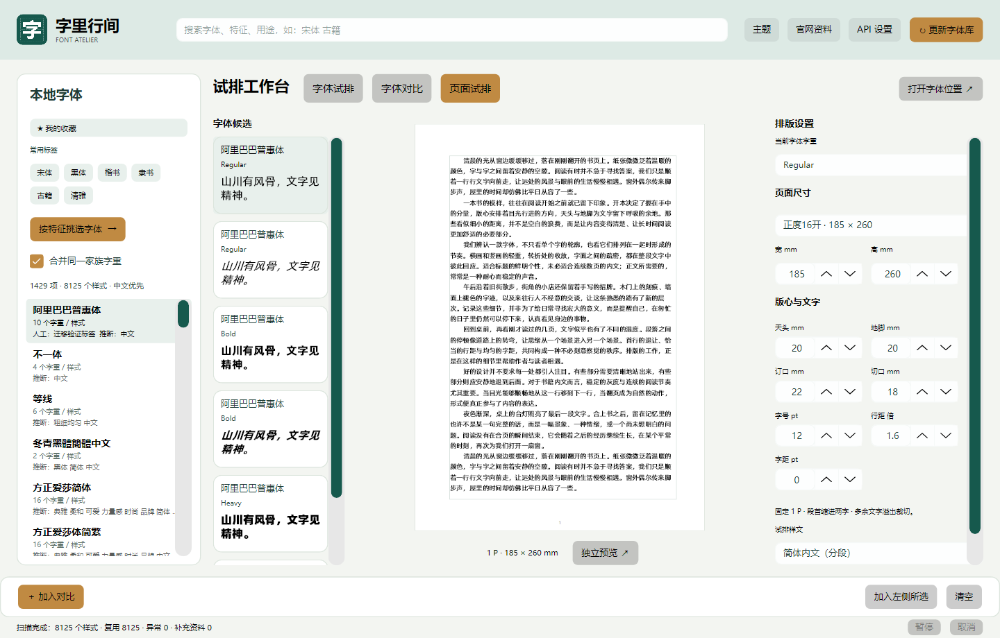

# 字里行间 · Windows 版

本目录保存 2026-10-29 整理的 Windows Avalonia 源码；macOS 和仓库根目录的共享源码保持原样。配套发布文件为 `FontFilter-Windows-x64.zip`。

## 使用

适用于 Windows 10/11 x64。将压缩包完整解压，再打开 `FontFilter/FontFilter.exe`，无需另装 .NET。首次点击“更新字体库”扫描本机字体。数据默认保存到 `%LOCALAPPDATA%\FontFilter`；软件不附带用户字体、扫描数据库、设置或日志。

当前 Windows 界面包括字体浏览、字体对比、书页试排、独立书页预览与屏幕标尺校准。字体资料为离线参考，不能作为商用授权证明。API 密钥仅留当前进程，发起分析前需核对发送内容。

## 构建

需要 .NET 8 SDK 和 PowerShell。依赖 Avalonia 11.3.22，首次构建需要还原 NuGet 包。

```powershell
cd windows
dotnet run --project tests/FontFilter.Tests -c Release
dotnet run --project src/FontFilter.Desktop
powershell -ExecutionPolicy Bypass -File scripts/publish-windows.ps1
```

脚本生成 `release/FontFilter-Windows-x64.zip`，包含 .NET 运行环境和第三方许可。`original/data/official-fonts.json` 是构建所需的随附官方资料库；未复制旧程序、个人数据或 macOS 安装包。

## 验证

2026-10-29：使用本机 NuGet 缓存离线还原后，核心测试 **61/61 通过**，Windows Desktop Release 构建成功（0 警告、0 错误）。发布 ZIP 取自当前已安装 Windows 应用（主程序修改时间 2026-10-28 19:54），并非本次重新编译。已安装的 `FontFilter.dll`、`FontFilter.Core.dll` 与本地对应 Release 构建产物 SHA-256 一致；源码最近修改早于主程序构建。尚未做可重现构建或完整二进制逐项源码溯源。

第三方许可见 `THIRD-PARTY-NOTICES.md` 和 `packaging/licenses/`。

## Windows 最新界面

以下图片由当前 Windows 版本自身导出，使用隔离验证数据与默认样文，不包含桌面、密钥或个人设置。



